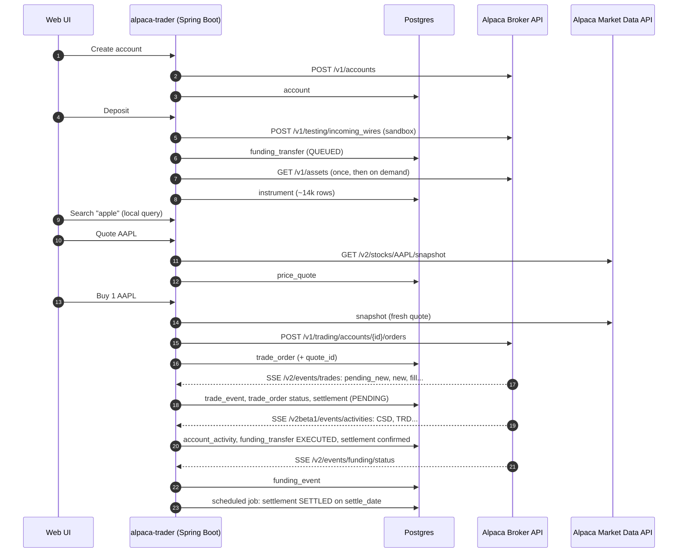

# Solution: end-to-end trade flow on Alpaca

This document describes how **alpaca-trader** runs a full trade flow against the Alpaca Broker API and
Market Data API:

1. Create an account.
2. Fund it.
3. Find an instrument.
4. Price it.
5. Place an order.
6. Follow the order's lifecycle through events.
7. Track settlement.

The service stores every step in Postgres. The web UI at `http://localhost:8080` reads from that database.



---

## 1. Databases

There is **one PostgreSQL 18 database** (`alpaca`). It runs in Docker (`compose.yaml`, service `db`) with the
data on the named volume `pgdata`. Inside the compose network it is at `db:5432`; from your machine it is at `localhost:5433`.

- **Schema management:** Liquibase (`src/main/resources/db/changelog`). It applies the changesets in
  `changes/001-trading-schema.sql` at startup and records them in its own tables, `databasechangelog` and
  `databasechangeloglock`.
- **Data access:** Spring `JdbcClient` with plain SQL. Upserts (`INSERT … ON CONFLICT`) make every write
  idempotent, so the same Alpaca object or event can arrive any number of times.
- **Raw payloads:** each table keeps the original Alpaca JSON in a `raw JSONB` column next to the
  normalised columns. This gives a full audit trail and lets you query fields that aren't modelled yet.

| Table | What it holds | Written by |
|---|---|---|
| `account` | Alpaca brokerage accounts managed by this app: id, account number, status, name, email | create/import account, refresh |
| `funding_transfer` | Deposits made by the app (simulated incoming wires): amount, status `QUEUED → EXECUTED` | funding request, then the CSD activity event |
| `instrument` | Cache of the tradable universe (active US equities): symbol, name, exchange, tradable, fractionable | asset sync (`GET /v1/assets`) |
| `price_quote` | Every price snapshot fetched: bid/ask with sizes, last trade, day OHLCV, previous close | quote lookups and order placement |
| `trade_order` | Orders placed through the app: request fields, current status, filled qty, average price, `quote_id` (the price seen when the order was sent) | order placement, then each trade event |
| `trade_event` | Every order lifecycle event (`pending_new`, `new`, `fill`, `partial_fill`, `canceled`, …) with execution id, price, qty, position qty, settle date. The primary key is Alpaca's ULID `event_id` | trades event stream |
| `settlement` | One row per execution (fill or partial fill): signed cash amount, trade date, settle date, status `PENDING → SETTLED`, and the ledger activity that confirmed it | trades stream, activities stream, scheduled job |
| `account_activity` | The account ledger as booked by Alpaca's back office: `TRD` (trade), `CSD` (cash deposit), `DIV`, `FEE`, … with net amount and settle date | activities event stream |
| `funding_event` | Status changes of transfers, bank relationships and wire banks | funding event stream |
| `event_stream_cursor` | Last processed `event_id` per stream, used to resume after a disconnect or restart | event stream runner |

Relations: `trade_order → account`, `trade_order → price_quote`, `trade_event → trade_order`,
`settlement → trade_event / trade_order / account`, `funding_transfer → account`.

---

## 2. The flow step by step, with the Alpaca endpoints used

All Broker API calls use an OAuth2 bearer token. The service gets it with the `client_credentials` grant
from `POST https://authx.sandbox.alpaca.markets/v1/oauth2/token`, caches it, and refreshes it shortly
before it expires. The Market Data API accepts the same token.

| # | Step | App endpoint (used by the UI) | Alpaca endpoint | Stored in |
|---|---|---|---|---|
| 1 | Create account | `POST /api/app/accounts` | `POST /v1/accounts` (KYC: contact, identity, disclosures, agreements) | `account` |
| 1b | Import an existing account | `POST /api/app/accounts/import` | `GET /v1/accounts/{id}` | `account` |
| 1c | Account and balances | `GET /api/app/accounts/{id}` | `GET /v1/accounts/{id}`, `GET /v1/trading/accounts/{id}/account` (cash, buying power, equity) | `account` (balances are live, not stored) |
| 2 | Fund the account | `POST /api/app/accounts/{id}/funding` | `POST /v1/testing/incoming_wires` (sandbox only; FFC `<correspondent>-<account_number>`) | `funding_transfer` |
| 3 | Load instruments | `POST /api/app/instruments/sync` (also runs automatically on first start) | `GET /v1/assets?status=active&asset_class=us_equity` | `instrument` |
| 3b | Search instruments | `GET /api/app/instruments?q=` | none (local database query) | |
| 4 | Price / quote | `POST /api/app/instruments/{symbol}/quote` | Market Data `GET /v2/stocks/{symbol}/snapshot?feed=iex` | `price_quote` |
| 5 | Place an order | `POST /api/app/accounts/{id}/orders` | snapshot (as in step 4), then `POST /v1/trading/accounts/{id}/orders` with our own `client_order_id` | `price_quote`, `trade_order` |
| 5b | Cancel an order | `DELETE /api/app/accounts/{id}/orders/{orderId}` | `DELETE /v1/trading/accounts/{id}/orders/{orderId}` | the result arrives as a trade event |
| 6 | Order lifecycle | (background) | SSE `GET /v2/events/trades` | `trade_event`, `trade_order`, `settlement` |
| 7 | Ledger / settlement | (background) | SSE `GET /v2beta1/events/activities` | `account_activity`, `settlement`, `funding_transfer` |
| 7b | Funding status | (background) | SSE `GET /v2/events/funding/status` | `funding_event` |
| | Read back for the UI | `GET /api/app/accounts/{id}/orders`, `/funding`, `/activities`, `/streams` | none (database only) | |

Notes per step:

- **Account creation.** The UI only asks for name, email and tax ID. Address, date of birth, disclosures and
  the customer, account and margin agreements are filled with sandbox defaults. Alpaca requires
  `identity.tax_id`. In the sandbox, KYC is approved automatically and the account becomes `ACTIVE`.
- **Funding.** Production funding goes through ACH or wire from a real bank. The sandbox simulates an incoming wire,
  which Alpaca books as a `CSD` (cash deposit) activity. When that activity arrives, the oldest open
  `funding_transfer` with the same amount is marked `EXECUTED`. Set `ALPACA_CORRESPONDENT` (your
  4-character correspondent code) for this to work.
- **Instruments.** The full asset list (~14,400 active US equities) is cached locally. Search is then a fast
  SQL query by symbol prefix or name substring, and doesn't count against Alpaca's rate limits.
- **Quotes.** Every quote lookup is stored. When an order is placed, the app takes a fresh snapshot first and links
  it to the order (`trade_order.quote_id`). That records the bid, ask and last price at the moment of the
  decision, which you can compare with the fill price later (slippage).
- **Orders.** The app generates `client_order_id` (`at-<uuid>`), so an order can always be matched back to
  the request that created it. Validation: exactly one of `qty` or `notional`, and the instrument must be
  tradable. Alpaca checks buying power and market rules.

---

## 3. How Alpaca sends events back

Alpaca doesn't call webhooks. It pushes events over **Server-Sent Events (SSE)**: long-lived HTTP GET
requests with `Content-Type: text/event-stream`. Each message is a `data: {json}` line followed by a
blank line. Lines starting with `:` are comments, for example `: welcome to the Alpaca events` on
connect and `: internal server error` before Alpaca drops the connection.

The service keeps **three streams** open, each on its own virtual thread (`AlpacaEventStreams`):

| Stream | Endpoint | Events |
|---|---|---|
| trades | `GET /v2/events/trades` | Order lifecycle: `pending_new`, `new`, `accepted`, `partial_fill`, `fill`, `canceled`, `expired`, `replaced`, `rejected`, `done_for_day`, … Each event carries the **full order object** plus, for executions, `execution_id`, `price`, `qty`, `position_qty`, `timestamp` and `settle_date`. |
| activities | `GET /v2beta1/events/activities` | Ledger entries from the back office: `TRD` (each execution booked, with `net_amount` and `settle_date`; `details.order_id` links it to the order), `CSD` (cash deposit), `DIV`, `FEE`, `JNLC`, … |
| funding | `GET /v2/events/funding/status` | Status transitions (`status_from → status_to`) of `Transfer`, `BankRelationship` and `WireBank` entities |

How the streams are consumed reliably:

- **Resume without gaps.** Every event has a ULID `event_id`. After each event the id is saved in
  `event_stream_cursor`. On reconnect or restart the stream reopens with `since_id=<cursor>`, and Alpaca
  replays everything after it before switching to live push. On first start there is no cursor, so the
  stream uses `since=<today − 1 day>` instead.
- **Idempotency.** Events are inserted with `ON CONFLICT (event_id) DO NOTHING`, so a replay is harmless.
- **Ordering.** Order rows are only overwritten by a snapshot whose `order.updated_at` is at least as new as the
  stored one, so a late or replayed `new` event can't overwrite `filled`.
- **Reconnects.** If a stream drops, it reconnects with exponential backoff (1 s up to 60 s). A single bad event
  is logged and skipped rather than blocking the stream.
- **Scope.** The streams carry events for **all** accounts of the correspondent. Only events for accounts in the
  `account` table are stored.
- **Status.** `GET /api/app/streams` shows connection state and counters for each stream. The UI shows this as the
  green dots in the top bar.

### Order lifecycle example (from a sandbox run)

```
POST order (market, buy 1 NVDA)  ->  trade_order status=pending_new, quote_id=#4 (bid 151.49 / ask 151.52)
trades:     pending_new                                  -> trade_event
trades:     new                                          -> trade_event, order status=new
trades:     fill 1 @ 151.58, settle_date 2026-11-18      -> trade_event, order status=filled,
                                                            settlement PENDING (-151.58, T+1)
activities: TRD 1 NVDA @ 151.58, net -151.58, executed   -> account_activity, settlement confirmed
2026-11-18: scheduled job                                -> settlement SETTLED
```

A limit order that is then cancelled produces `pending_new → new → canceled`, with no executions.

---

## 4. Settlement

US equities settle **T+1**: the trade date plus one business day. Alpaca handles clearing and settlement
with the clearing house, and it **doesn't send a separate "settled" event per trade**. The service
reconstructs settlement in three stages:

1. **Execution → PENDING.** Each `fill` or `partial_fill` trade event creates one `settlement` row, keyed by
   `execution_id`. The row holds qty, price, the signed cash amount (buy = negative), the trade date (New York
   time) and `settle_date` from the event. If the event has no settle date, the next business day is used.
2. **Ledger confirmation.** The matching `TRD` activity on the activities stream (same order id, qty and
   price) proves the execution was booked to the account. The settlement then gets `activity_event_id` and
   `activity_status`, and Alpaca's ledger `settle_date` replaces the calculated one. The two streams are independent, so
   whichever event arrives second does the matching. The minute job also retries the matching.
3. **SETTLED.** A scheduled job runs every minute and marks `PENDING` settlements as `SETTLED` once
   `settle_date` has been reached in New York time. From that date the cash or shares are settled in the account, which also shows
   in the account's settled cash (`GET /v1/trading/accounts/{id}/account`).

For a broker-dealer the next step is to reconcile with Alpaca's end-of-day reports, for example
`GET /v1/reporting/eod/positions` and `/v1/reporting/eod/cash_interest`. These aren't wired in yet.

---

## 5. Web UI

The UI is plain HTML, CSS and JavaScript in `src/main/resources/static`, served by Spring Boot at `http://localhost:8080`.

- **Top bar.** An account switcher (accounts from the database; the choice is remembered in localStorage),
  live balances (cash, buying power, equity, positions), and the state of the three event streams.
- **Accounts.** Create an account (sent to Alpaca, then stored), import an existing one by id, account
  details, a deposit button (simulated wire) and the deposit list with status.
- **Instruments.** Type-ahead search over the local instrument table, plus a sync button. Selecting an instrument
  fetches and stores a quote (bid/ask with sizes, last, day change and range) and opens an order ticket:
  buy/sell, market/limit/stop/stop-limit, time in force, quantity or notional, and an estimated cost.
- **Orders.** Orders of the selected account from the database, refreshed every 3 seconds: status, filled
  qty, average price and the quote at entry. Open orders have a cancel button. Expanding an order shows:
  - **Executions reported by Alpaca:** time, qty, price, amount, trade date, settle date, settlement status,
    and whether the ledger (`TRD` activity) has confirmed the execution.
  - **Order lifecycle:** a timeline of every trade event received.

---

## 6. Running it

```bash
cp .env.example .env    # ALPACA_CLIENT_ID, ALPACA_CLIENT_SECRET, ALPACA_CORRESPONDENT
docker compose up -d --build
```

Then open http://localhost:8080. Swagger UI for every endpoint is at http://localhost:8080/swagger-ui.html.

## 7. Known limitations

- **Sandbox only.** Funding uses the sandbox wire simulator, and the defaults point at the sandbox URLs. Production funding would
  use ACH relationships plus transfers, or real wires.
- **Settlement by date.** `SETTLED` is derived from the settle date, not from a clearing confirmation, because Alpaca
  doesn't push one per trade.
- **No authentication.** The UI and API have none and are meant for local use only.
- **Single instance.** The event consumers assume one running instance. A second instance would process the same events. That stays
  correct because every write is idempotent, but the work is duplicated. Running several instances would need leader election.
- **Beta endpoint.** `/v2beta1/events/activities` is a beta endpoint.
